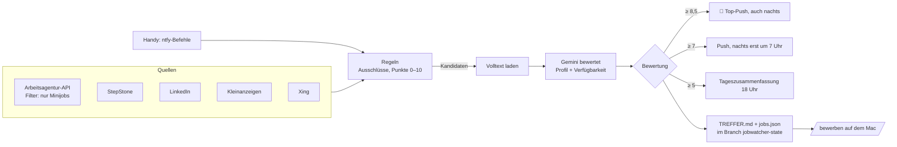

# Job-Watcher

Sucht alle 30 Minuten Minijobs rund um Dreieich, vor allem **Fahrzeugüberführungen**, bewertet jede Anzeige
und schickt eine Push-Benachrichtigung aufs iPhone (über [ntfy](https://ntfy.sh)), sobald ein **neuer guter**
Job auftaucht. Läuft kostenlos in GitHub Actions, ohne Mac.



## Quellen

| Quelle | Zugriff | Bemerkung |
|---|---|---|
| Arbeitsagentur | offizielle REST-API (`pc/v6/jobs`, Filter `arbeitszeit=mj`) | beste Quelle: sicher Minijob, Entfernung, Lohn |
| StepStone | JSON im Seitenquelltext | |
| LinkedIn | öffentliche Gast-Suche, kein Login | |
| Kleinanzeigen | Kategorie Jobs, Umkreis Dreieich | Gesuche werden übersprungen |
| Xing | JSON im Seitenquelltext, kein Login | |

**Nicht dabei, mit Grund:**
- **Indeed** blockt automatische Abfragen (HTTP 403, Cloudflare). Die meisten Indeed-Stellen stehen auch bei der Arbeitsagentur oder StepStone.
- **Onlogist** vermittelt Überführungen nur an Selbstständige mit Gewerbe (Provision bis 15 %), das ist kein Minijob ([Onlogist](https://onlogist.com/en/blog/selbstaendiger-fahrer-werden)). Deine Logins werden nirgends gebraucht.

## Bewertung

Jede Anzeige bekommt 0–10 Punkte. Erst Regeln (`jobwatcher/rules.py`), dann für die besten Kandidaten Gemini.

| Regel | Wirkung |
|---|---|
| Lkw/Bus/Stapler im Titel, Klasse C/CE/D, Fahrerkarte | ausgeschlossen |
| selbstständig, Subunternehmer, Gewerbe | ausgeschlossen |
| Mindestalter über 24, Führerschein länger als 5 Jahre gefordert | ausgeschlossen |
| Ausbildung, Praktikum, Sicherheitsdienst (§34a), Uber/Bolt | ausgeschlossen |
| weiter als 40 km | ausgeschlossen |
| Grundwert: Überführung/Autohaus 6 · Fahrer 3,5 · anderer Job 1,5 | |
| Minijob sicher +1,5 · erwähnt +0,8 · unklar −1 · Teil-/Vollzeit −2,5 | |
| Wochenende +1,5 · flexibel +1 · abends +0,5 (zusammen max. +2) | |
| Mo–Fr / vormittags −1 · Werkstudent −2,5 · P-Schein −2 · Winterdienst −2,5 | |
| ≤ 15 km +1 · > 30 km −1 · ≥ 18 €/h +1 · ≥ 15 €/h +0,5 · unter Mindestlohn −1 | |
| Ohne KI höchstens: Fahrer 8, anderer Job 6,5 | |

Gemini bekommt Profil und Verfügbarkeit aus `config.yaml` und gibt eine eigene Bewertung mit Begründung.
Diese ersetzt die Regel-Bewertung. Harte Ausschlüsse gelten trotzdem. Ohne `GEMINI_API_KEY` oder bei
leerem Kontingent laufen nur die Regeln.

**Anpassen:** Alles Wichtige steht in `config.yaml` (Umkreis, Verfügbarkeit, Schwellen, Suchbegriffe).
Änderung auf `main` pushen, der nächste Lauf nutzt sie.

## Pushes

| Was | Wann | ntfy-Priorität |
|---|---|---|
| 🚨 TOP (≥ 8,5) | sofort, auch nachts | 5 |
| Guter Treffer (≥ 7) | sofort, 22–7 Uhr gesammelt um 7 Uhr | 4 |
| 📋 Tageszusammenfassung (5–7) | 18 Uhr, nur wenn es etwas gibt | 2 |
| 💚 Lebenszeichen | sonntags 10 Uhr | 2 |
| ⚠️ Quelle gestört | nach 6 Fehlläufen in Folge (≈ 3 h), und wenn sie wieder läuft | 3 |
| ❌ Absturz | höchstens alle 12 h dieselbe Meldung | 3 |

Jeder Treffer-Push hat Knöpfe „Anzeige öffnen“, „Alle Treffer“ (TREFFER.md auf GitHub) und „Pause 8 h“,
und enthält die Zeile `/bewerben <ID>`. Höchstens 5 Einzel-Pushes pro Lauf.
Der **erste Start** meldet keine alten Anzeigen einzeln, sondern schickt eine Übersicht.

## Steuerung vom Handy

Befehl als Nachricht an das Steuer-Topic schicken:
- **Safari:** `https://ntfy.sh/<STEUER-TOPIC>` öffnen, Text eingeben, senden. Als Lesezeichen auf den Home-Bildschirm legen.
- **iPhone-Kurzbefehl** (wie beim Schichtwatcher): „Inhalte von URL abrufen“, URL `https://ntfy.sh/<STEUER-TOPIC>`,
  Methode `POST`, Anfragetext = Befehl.
- **Knopf „Pause 8 h“** in jedem Treffer-Push.

GitHub Actions läuft nicht dauerhaft. Der Befehl wirkt darum beim nächsten Lauf, spätestens nach 30 Minuten.

| Befehl | Wirkung |
|---|---|
| `status` | letzter Lauf, Schwelle, Fehler |
| `top` | die 6 besten aktiven Treffer |
| `pause 8` / `weiter` | 8 Stunden keine Pushes (gesucht wird weiter) |
| `schwelle 6.5` | Pushes ab 6,5 Punkten |
| `quelle xing aus` / `quelle xing an` | eine Quelle ab- oder zuschalten |

**Sofort prüfen:** GitHub-App → Repo FAAH → Actions → Job-Watcher → „Run workflow“.

## Einrichtung (einmalig, ca. 10 Minuten)

1. **Repo privat stellen:** github.com/Caylipp/FAAH → Settings → ganz unten „Danger Zone“ →
   „Change visibility“ → Private. Solange das Repo öffentlich ist, macht der Workflow nur Trockenläufe
   (keine Pushes, kein Speichern), damit deine Treffer nicht öffentlich werden.
2. **ntfy:** App installieren, zwei zufällige Topic-Namen ausdenken (z. B. `jobs-k7x2m9q4w`), eines für
   Pushes, eines für Befehle. Beide in der App abonnieren. Der Name ist das Passwort.
3. **Gemini-Key:** [aistudio.google.com](https://aistudio.google.com) → „Get API key“.
4. **Secrets anlegen:** Repo → Settings → Secrets and variables → Actions → „New repository secret“:
   `NTFY_TOPIC`, `NTFY_CONTROL_TOPIC`, `GEMINI_API_KEY`.
5. **Starten:** Actions → Job-Watcher → „Run workflow“. Nach 1–3 Läufen kommt „🟢 Job-Watcher gestartet“.

## Bewerben mit Claude Code (Mac)

```bash
git clone https://github.com/Caylipp/FAAH && cd FAAH/jobwatcher
cp bewerbung/profil.example.md bewerbung/profil.md   # ausfüllen, Lebenslauf als bewerbung/lebenslauf.pdf
claude
> /bewerben ba:10001-1003648922-S
```

Claude lädt den Job aus dem State-Branch, prüft die Anzeige, schreibt ein kurzes Anschreiben, füllt Formular
oder E-Mail vor und fragt **vor dem Absenden** nach deinem „ja“. Persönliche Daten (`profil.md`, Entwürfe,
Lebenslauf, Protokoll) bleiben durch `.gitignore` auf dem Mac.

## Lokal laufen lassen (optional)

```bash
cd FAAH/jobwatcher
python3 -m venv .venv && .venv/bin/pip install -r requirements.txt
cp .env.example .env                       # Werte eintragen
.venv/bin/python -m jobwatcher test-push   # Test-Push
.venv/bin/python -m jobwatcher run --dry   # ein Lauf ohne Pushes, State in .state/
.venv/bin/python -m jobwatcher show        # Trefferliste im Terminal
.venv/bin/python -m pytest -q              # Tests
```

Nicht parallel zu GitHub Actions mit denselben Topics betreiben: beide hätten getrennten Zustand und würden doppelt melden.

## Kosten

- GitHub Actions (privates Repo): 2.000 Freiminuten im Monat. Der Watcher braucht ca. 33 Läufe × 1 Minute
  × 31 Tage ≈ 1.020 Minuten. Mehr Läufe: `cron` in `.github/workflows/jobwatcher.yml` ändern.
  Verbrauch: github.com/settings/billing.
- Gemini: Gratis-Kontingent; der Watcher bündelt 8 Anzeigen pro Anfrage und bewertet höchstens 40 pro Lauf.
- ntfy.sh: kostenlos.

## Dateien

| Pfad | Inhalt |
|---|---|
| `config.yaml` | Wohnort, Umkreis, Profil, Verfügbarkeit, Schwellen, Suchbegriffe |
| `jobwatcher/sources/` | eine Datei je Portal (`search`, `parse`, `fetch_details`) |
| `jobwatcher/rules.py` | Regel-Bewertung und Ausschlüsse |
| `jobwatcher/ai.py` | Gemini-Bewertung |
| `jobwatcher/runner.py` | Ablauf eines Laufs, Pushes, Ruhezeit, Zusammenfassung |
| `jobwatcher/control.py` | Handy-Befehle |
| `.claude/commands/bewerben.md` | `/bewerben` für Claude Code |
| Branch `jobwatcher-state` | `state.json`, `jobs.json`, `TREFFER.md` (wird jeden Lauf ersetzt) |
| `../.github/workflows/jobwatcher.yml` | Zeitplan und Ablauf in GitHub Actions |

## Wenn etwas nicht geht

- **Kein Push:** Secrets richtig benannt? `python -m jobwatcher test-push` lokal testen. Actions-Log ansehen.
- **„Quelle … gestört“:** Das Portal hat wahrscheinlich sein Format geändert. `pytest` zeigt, welcher Parser bricht.
- **Zu viele / zu wenige Pushes:** `schwelle 7.5` bzw. `schwelle 6` per Handy, oder `config.yaml` anpassen.
- **Actions läuft nicht mehr:** GitHub pausiert Zeitpläne, wenn das Konto inaktiv wird; im Actions-Tab wieder aktivieren.
